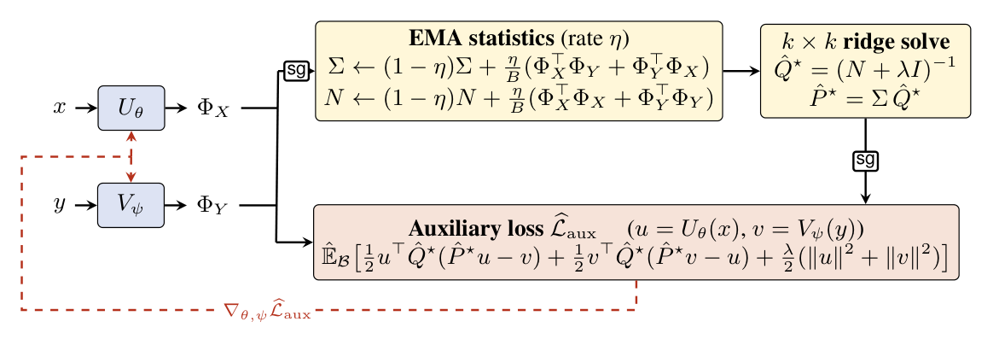

<h1 align="center">
    <p><b>PEIRA: Learning Predictive Encoders through Inter-View Regressor Alignment</b></p>
</h1>

<div align="center" style="line-height: 1;">
  <a href="https://peira-ssl.github.io" target="_blank" style="margin: 2px;"></a>
  <a href="https://arxiv.org/abs/2605.17671" target="_blank" style="margin: 2px;"></a>
  <a href="https://neurips.cc/virtual/2026/loc/sydney/poster/153191" target="_blank" style="margin: 2px;"></a>
  <a href="https://huggingface.co/peira-ssl/PEIRA" target="_blank" style="margin: 2px;"></a>
</div>

<br>

<p align="center">
  Michael Arbel*,
  Basile Terver*,
  Jean Ponce
</p>

<p align="center"><sub>* equal contribution</sub></p>

<p align="center">
  
</p>

<p align="center"><sub><b>One step of PEIRA.</b> Both views are encoded into features Φ<sub>X</sub>, Φ<sub>Y</sub>.
Through a stop-gradient (sg), their second moments update EMA estimates of the signal Σ and noise N,
which give the ridge regressors P̂*, Q̂* in closed form by a k×k inversion. With P̂*, Q̂* held fixed,
only the encoders are updated (dashed): no target encoder, no backpropagation through the inverse.</sub></p>

---

PEIRA is a non-contrastive self-supervised loss. A ridge regressor, computed in closed form from
running (EMA) covariances of the two views, predicts one view's embedding from the other's, and
the encoder is trained to align with it. This prevents collapse without negatives, a teacher or
a target encoder.

This repository contains the training and evaluation code for the paper: ImageNet-1K
pretraining of ResNet-50 with PEIRA, SIGReg and VICReg (linear probe, transfer, appendix
ablations), CIFAR-10 with ResNet-18, and the synthetic two-view experiment. The loss itself is
the standalone [`peira-loss`](https://github.com/MichaelArbel/peira-loss) package (`pip install peira-loss`); the training utilities are a vendored subset of
[EB-JEPA](https://github.com/facebookresearch/eb_jepa).

**Contents:** [Install](#install) · [Data](#data) · [Pretrained checkpoints](#pretrained-checkpoints) ·
[Reproducing the paper](#reproducing-the-paper) ([main paper](#main-paper), [appendix](#appendix)) ·
[Repository layout](#repository-layout) · [Citation](#citation)

## Install

```bash
conda create -n peira python=3.12 -y && conda activate peira
pip install peira-loss                 # PEIRA loss package (github.com/MichaelArbel/peira-loss)
pip install -e .
```

## Data

Set `EBJEPA_DSETS` to the root of your datasets (`export EBJEPA_DSETS=/path/to/datasets`); every
training and probing command reads it.

- **ImageNet-1K** (`$EBJEPA_DSETS/ImageNet`): either an `ImageFolder` tree
  (`ImageNet/{train,val}/<wnid>/*.JPEG`) or a Hugging Face `DatasetDict` saved with
  `save_to_disk` (`ImageNet/dataset_dict.json`).
- **CIFAR-10**: downloaded by torchvision into `$EBJEPA_DSETS` on first use.
- **Transfer suite** (CIFAR-10/100, DTD, Flowers102, Pets, Food101, Aircraft, Stanford Cars):
  `python -m data.stage_transfer --root $EBJEPA_DSETS/transfer` downloads every train/test split
  (Stanford Cars from the Hugging Face hub, the others through torchvision).

## Pretrained checkpoints

ResNet-50 backbones after 100 epochs of ImageNet-1K pretraining (Table 1), hosted on
[🤗 peira-ssl/PEIRA](https://huggingface.co/peira-ssl/PEIRA). Each file holds the backbone
weights only (`model_state_dict`, no projector), the training `config` and a `metadata` dict
(method, projector dims, seed, top-1). Top-1 is the offline linear probe of `probe.py`.

| Method | k (projector output) | Seed 1 | Seed 1000 | Seed 10000 |
|---|---|---|---|---|
| PEIRA | 256 | [66.51](https://huggingface.co/peira-ssl/PEIRA/blob/main/in1k_rn50_peira_k256_seed1.pth) | [66.32](https://huggingface.co/peira-ssl/PEIRA/blob/main/in1k_rn50_peira_k256_seed1000.pth) | [66.51](https://huggingface.co/peira-ssl/PEIRA/blob/main/in1k_rn50_peira_k256_seed10000.pth) |
| PEIRA | 1024 | [69.23](https://huggingface.co/peira-ssl/PEIRA/blob/main/in1k_rn50_peira_k1024_seed1.pth) | [69.12](https://huggingface.co/peira-ssl/PEIRA/blob/main/in1k_rn50_peira_k1024_seed1000.pth) | [69.15](https://huggingface.co/peira-ssl/PEIRA/blob/main/in1k_rn50_peira_k1024_seed10000.pth) |
| SIGReg | 128 | [66.46](https://huggingface.co/peira-ssl/PEIRA/blob/main/in1k_rn50_sigreg_seed1.pth) | [66.38](https://huggingface.co/peira-ssl/PEIRA/blob/main/in1k_rn50_sigreg_seed1000.pth) | [65.94](https://huggingface.co/peira-ssl/PEIRA/blob/main/in1k_rn50_sigreg_seed10000.pth) |
| VICReg | 8192 | [68.80](https://huggingface.co/peira-ssl/PEIRA/blob/main/in1k_rn50_vicreg_seed1.pth) | [68.71](https://huggingface.co/peira-ssl/PEIRA/blob/main/in1k_rn50_vicreg_seed1000.pth) | [68.90](https://huggingface.co/peira-ssl/PEIRA/blob/main/in1k_rn50_vicreg_seed10000.pth) |

Each number links to its weights. `probe.py --ckpt` accepts these files directly; the
`analysis/` scripts need the projector, so they require a full training checkpoint:

```python
from huggingface_hub import hf_hub_download

print(hf_hub_download("peira-ssl/PEIRA", "in1k_rn50_peira_k1024_seed1.pth"))  # <ckpt>
```

```bash
mkdir -p peira_k1024
torchrun --nproc_per_node=8 probe.py --ckpt <ckpt> --data-dir $EBJEPA_DSETS/ImageNet \
  --out peira_k1024/offline_probe.json
python probe.py --ckpt <ckpt> --datasets lejepa8 --transfer-root $EBJEPA_DSETS/transfer \
  --out peira_k1024/transfer.json
```

Pass `--out` so the probe JSON is not written into the Hugging Face cache. With these names,
`figures/transfer_table.py --row "PEIRA=peira_k1024"` reads both results. To export your own
training checkpoint in this format, run the ImageNet-1K probe on it first (its top-1 goes into
the metadata), then `python -m scripts.export_hf --ckpt <run_dir>/latest.pth.tar --out-dir <dir>`.

## Reproducing the paper

**Hardware.** ImageNet-1K runs use one node of 8 GPUs (8xH200 in the paper, 17 to 23 h per
100-epoch run). CIFAR-10 runs use one GPU (about 3.5 h on an H100). The ImageNet-1K configs use
32 data-loading workers per GPU; if workers die with `Bus error ... out of shared memory`, lower
`--data.num_workers` (8 runs at the same speed on a node with 64 GB of `/dev/shm`).

**Configs and overrides.** Every config key can be overridden on the command line, e.g.
`--optim.lr=1.2 --meta.seed=1000`.

**Checkpoints and resuming.** Checkpoints go to `--folder`. `latest.pth.tar` is rewritten every
epoch, and every 50 steps with the ImageNet-1K configs; `--logging.save_every=N` also keeps an `e-N.pth.tar` snapshot every N
epochs (needed by some appendix commands below). Relaunching with the same `--folder` resumes;
a finished run exits immediately.

**SLURM.** `eb_jepa/utils/distributed.py` falls back to the `SLURM_*` variables when the torchrun
ones are absent, so on a single node
`srun --nodes=1 --ntasks-per-node=8 --gpus-per-node=8 python train.py --fname ...` replaces
`torchrun --nproc_per_node=8 train.py --fname ...`.

### Main paper

**Without pretraining.** The ImageNet-1K and transfer columns of Table 1 can be checked directly
on the [pretrained checkpoints](#pretrained-checkpoints): run the two `probe.py` commands of
[Pretrained checkpoints](#pretrained-checkpoints) on a downloaded file.

#### Table 1, ImageNet-1K column

ResNet-50, 100 epochs, then the offline linear probe (VICReg protocol: SGD, 100 epochs,
batch 1024, lr 0.25), which writes `offline_probe.json` (`final_top1`) next to the checkpoint.

```bash
for cfg in peira_resnet50 peira_k1024_resnet50 sigreg_resnet50 vicreg_resnet50; do
  for seed in 1 1000 10000; do
    run=checkpoints/$(basename ${cfg})_seed${seed}
    mkdir -p ${run}
    torchrun --nproc_per_node=8 train.py --fname configs/in1k/${cfg}.yaml \
      --folder ${run} --meta.seed=${seed} 2>&1 | tee -a ${run}/train.log
    torchrun --nproc_per_node=8 probe.py --ckpt ${run}/latest.pth.tar \
      --data-dir $EBJEPA_DSETS/ImageNet
  done
done
```

| Method | ImageNet-1K top-1 (mean ± std, 3 seeds) |
|---|---|
| PEIRA (k=256) | 66.45 ± 0.11 |
| PEIRA (k=1024) | 69.17 ± 0.06 |
| SIGReg (k=128) | 66.26 ± 0.28 |
| VICReg (k=8192) | 68.81 ± 0.09 |

#### Table 1, CIFAR-10 column

ResNet-18, 1000 epochs, one GPU. Top-1 is `c10_val_acc` of the last epoch in
`metrics.jsonl` (online linear probe on the 10k test images).

```bash
for method in peira sigreg vicreg; do
  for seed in 42 43 44; do
    run=checkpoints/c10_${method}_seed${seed}
    mkdir -p ${run}
    python train.py --fname configs/cifar10/${method}_resnet18.yaml \
      --folder ${run} --meta.seed=${seed} 2>&1 | tee -a ${run}/train.log
  done
done
# PEIRA k=256, in its own folder (the same folder would resume the finished k=1024 run)
for seed in 42 43 44; do
  run=checkpoints/c10_peira_k256_seed${seed}
  mkdir -p ${run}
  python train.py --fname configs/cifar10/peira_resnet18.yaml --folder ${run} \
    --meta.seed=${seed} --model.proj_output_dim=256 2>&1 | tee -a ${run}/train.log
done
```

| Method | CIFAR-10 top-1 (mean ± std, 3 seeds) |
|---|---|
| PEIRA (k=256) | 91.36 ± 0.12 |
| PEIRA (k=1024) | 91.68 ± 0.18 |
| SIGReg | 92.34 ± 0.21 |
| VICReg | 90.92 ± 0.14 |

#### Table 1, Transfer column

Linear probes (Adam, 100 epochs, weight decay picked on a 10% holdout) on frozen, standardized
features of the eight LeJEPA transfer datasets (`--datasets lejepa8`). The JSON holds each dataset and
`transfer_mean`.

```bash
run=checkpoints/peira_resnet50_seed1
python probe.py --ckpt ${run}/latest.pth.tar --datasets lejepa8 \
  --transfer-root $EBJEPA_DSETS/transfer --out ${run}/transfer.json
```

Expected `transfer_mean`: PEIRA k=256 70.89 ± 0.18, PEIRA k=1024 71.09 ± 0.24 (3 seeds),
SIGReg 68.27, VICReg 72.07 (seed 1).

#### Figure 1: PEIRA dynamics on CIFAR-10

Online-probe accuracy against the negative PEIRA objective, plus the projector spectrum and its
alignment over training, from the diagnostics logged by a CIFAR-10 run above:

```bash
python figures/cifar10_dynamics.py checkpoints/c10_peira_seed42 --out figures/out/cifar10_dynamics
```

This writes the `_both`, `_spectrum` and `_alignment` panels as PDF and PNG, without loading
checkpoints or data. Spectral plots show up to ten logged epochs; pick them with
`--epochs 0 200 400 600 800`.

#### Figure 2: PEIRA regularization on ImageNet-1K

Train the λ grid in the [ablation setting](#appendix), then plot the three panels from the
`metrics.jsonl` of each run:

```bash
for reg in 0.025 0.05 0.1 0.2 0.5; do
  run=checkpoints/lambda_${reg}
  mkdir -p ${run}
  torchrun --nproc_per_node=8 train.py --fname configs/in1k/ablations/peira_batch_sigma.yaml \
    --folder ${run} --loss.reg=${reg} --logging.save_every=25 2>&1 | tee -a ${run}/train.log
done
python figures/lambda_sensitivity.py checkpoints/lambda_* --out figures/out/in1k_peira_sensitivity.pdf
python figures/effective_rank.py checkpoints/lambda_* --mode trajectory --out figures/out/in1k_peira_eff_rank_trajectory.pdf
python figures/loss_vs_accuracy.py checkpoints/lambda_* --epochs 24 49 74 99 --out figures/out/in1k_peira_loss_vs_acc.pdf
```

The paper's grid also varies `--loss.lr_min`, `--optim.weight_decay` and `--optim.grad_clip`
(pooled in the left and right panels). The paper figures, like Figures G.2 to G.4, were drawn
from our original training logs. `--epochs` indexes `metrics.jsonl` from 0 (24 is the 25th
epoch).

### Appendix

**ImageNet-1K ablation setting.** As stated in Appendix G.1 of the paper, the ImageNet-1K
ablations of PEIRA anneal the covariance EMA rate η (`loss.lr` → `loss.lr_min`) from 0.9 to 0.5
and use the mini-batch estimate of Σ in the regressor (`loss.predictor_cov=batch`). Their base
config is `configs/in1k/ablations/peira_batch_sigma.yaml`, and every
`configs/in1k/ablations/peira_*.yaml` builds on it.
Seed 1 unless noted; ImageNet-1K runs are probed as in Table 1.

| Paper result | Command | Expected |
|---|---|---|
| Table G.4, projector width | `train.py` on `ablations/peira_k{64,512,1024,2048}.yaml` and `peira_batch_sigma.yaml` (k=256), seeds 1/1000/10000 (k=64: seed 1) | k=64/256/512/1024/2048: 61.74/66.50/67.88/68.50/68.14 |
| Table G.5, longer pretraining | `ablations/{peira,vicreg}_ep300.yaml` with `--logging.save_every=100`, then probe `e-200.pth.tar` and `e-300.pth.tar` with `--out ${run}/probe_e200.json` / `probe_e300.json` (the default output name is shared) | epoch 200/300: PEIRA 66.1/68.3, VICReg 68.4/70.7 |
| Table G.6, EMA schedule | `ablations/peira_ema*.yaml` (default (0.9, 0.5) = `peira_batch_sigma.yaml`) | 65.88 to 66.48 |
| Table G.7, batch size | `ablations/peira_bs{512,1024,4096}.yaml`; B=2048 is `peira_batch_sigma.yaml` (lr = 0.3 B/256) | B=512/1024/2048/4096: 63.85/66.11/66.23/64.50 |
| Table G.8, training cost | `python -m analysis.epoch_time PEIRA=<log> SIGReg=<log> VICReg=<log>` on the Table 1 `train.log` files | s/epoch on 8xH200 (hardware dependent): PEIRA 626, SIGReg 809, VICReg 822 |
| Table G.9, per-dataset transfer | `python figures/transfer_table.py --row "PEIRA=checkpoints/peira_resnet50_seed1" ...` (reads `transfer.json` and `offline_probe.json` of each run) | means as in Table 1 |
| Figure G.2, effective rank vs λ | `python figures/effective_rank.py checkpoints/lambda_* --mode end` | figure |
| Figure G.3, SIGReg diagnostics | `train.py` on `sigreg_resnet50.yaml` with `--loss.lmbd` in {0.005, 0.01, 0.02} and one `--folder` each, then the three Figure 2 scripts on these run dirs (λ = `loss.lmbd`) | figure |
| Figure G.4, VICReg diagnostics | `python figures/baselines.py "LABEL=RUN_DIR" ...` (one label per recipe, its seeds share the label) | figure |
| Figure G.5, synthetic strict rank | `python synthetic/strict_rank.py --depth 0 --epochs 250 --seed 0` (CPU, 6 to 20 min depending on cores, writes `synthetic/out/strict_rank.{json,pdf}`) | rank 6/5/4/3/2/1/0 = r_max |
| Figure G.6, toy dynamics | see [CIFAR-10 initialization scale and toy data](#cifar-10-initialization-scale-and-toy-data) | figure |
| Figure G.7, CIFAR-10 initialization scale | see [CIFAR-10 initialization scale and toy data](#cifar-10-initialization-scale-and-toy-data) | `c10_val_acc` per scale (no plotting script) |

Two further diagnostics:

- `python -m analysis.effective_rank --ckpt <ckpt> --data-dir $EBJEPA_DSETS/ImageNet --out erank.json`
  gives the held-out effective rank and its Gaussian ceiling (PEIRA k=256 in the ablation setting: backbone ~1461,
  projector erank/k ~0.987, as in Table G.4).
- `python -m analysis.peira_objective --ckpt <run>/e-{25,50,75,100}.pth.tar --data-dir $EBJEPA_DSETS/ImageNet`
  prints −E_PEIRA, the closed-form objective, at each checkpoint; train with
  `--logging.save_every=25` to keep these snapshots. `e-N.pth.tar` is saved after epoch index N
  (N+1 epochs), except the final `e-<epochs>.pth.tar`.

#### CIFAR-10 initialization scale and toy data

**Figure G.7.** PEIRA and self-distillation on CIFAR-10, seeds 42/43/44, initialization
scales 0.01/0.1/1/10. Scales other than 1 re-initialize the model with scaled weights; scale 1
keeps the default initialization:

```bash
for method in peira self_distillation_joint; do
  for seed in 42 43 44; do
    for init in 0.01 0.1 1 10; do
      run=checkpoints/c10_${method}_seed${seed}_init${init}
      mkdir -p ${run}
      python train.py --fname configs/cifar10/${method}_resnet18.yaml \
        --folder ${run} --meta.seed=${seed} --init.scale=${init} 2>&1 | tee -a ${run}/train.log
    done
  done
done
```

The PEIRA config is the Table 1 recipe, which gives the bottom row of Figure G.7. For the top
row (mini-batch Σ, η from 0.8 to 0.5), add `--loss.predictor_cov=batch --loss.lr=0.8
--loss.lr_min=0.5` to the PEIRA runs, with their own `--folder`. For self-distillation,
`loss.lr` is the step size of its implicit predictor update, not a covariance EMA rate.

**Figure G.6.** For the deterministic toy experiments (spectral ratios and eigenvector
alignment), see the
[reference algorithms README](https://github.com/MichaelArbel/peira-loss/blob/main/reference_algorithms/README.md),
which explains how to launch the runs and plot the figures.

## Repository layout

```
train.py                 pretraining (single GPU or torchrun), online linear probe for monitoring
probe.py                 frozen-backbone probes: ImageNet-1K offline probe and transfer suite
models.py                ResNet backbone, projector, linear probe
metrics.py               online-probe evaluation, spectral diagnostics
data/                    augmentations, ImageNet/CIFAR-10 datasets, transfer suite (stage_transfer.py)
configs/in1k/            Table 1 recipes: peira_resnet50.yaml (k=256), peira_k1024_resnet50.yaml,
                         sigreg_resnet50.yaml, vicreg_resnet50.yaml
configs/in1k/ablations/  appendix ablations, as _base_ overrides of peira_batch_sigma.yaml
configs/cifar10/         Table 1 recipes {peira,sigreg,vicreg}_resnet18.yaml, self-distillation baseline
analysis/                held-out effective rank, PEIRA objective at checkpoints, epoch time
figures/                 one script per paper figure/table, reading run dirs and probe JSONs
synthetic/               synthetic two-view experiment (strict-rank staircase)
scripts/export_hf.py     weights-only release files for the Hugging Face hub
eb_jepa/                 vendored subset of EB-JEPA (losses, checkpointing, LARS, distributed)
```

## Citation

```bibtex
@inproceedings{arbel2026peira,
  title     = {{PEIRA}: Learning Predictive Encoders through Inter-View Regressor Alignment},
  author    = {Arbel, Michael and Terver, Basile and Ponce, Jean},
  booktitle = {Advances in Neural Information Processing Systems (NeurIPS)},
  year      = {2026},
  eprint    = {2605.17671},
  archivePrefix = {arXiv},
}
```

## License

Apache-2.0 (see [LICENSE](LICENSE)). `eb_jepa/` is a modified subset of
[EB-JEPA](https://github.com/facebookresearch/eb_jepa) (Apache-2.0); see
[eb_jepa/NOTICE](eb_jepa/NOTICE) for the upstream commit and the modifications.
